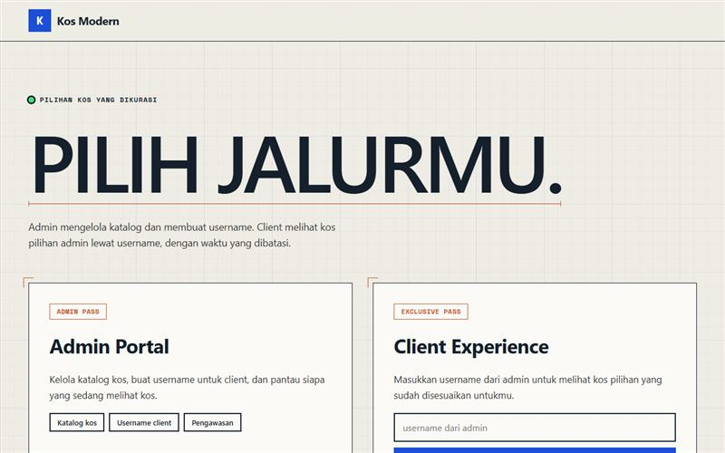

# Kos Modern

Katalog kos dua peran dengan akses berwaktu di atas Supabase.

**Demo:** https://portofolio-jauza-fawaid.netlify.app/KATALOG-KOS/

Website statis (HTML + CSS + JS) yang terhubung ke Supabase.

## Mode demo
Repo dan demo ini memakai data acak dari `js/demo.js`, tanpa koneksi ke database. Semua kos, nama, nomor, dan foto hanya contoh. Perubahan yang dibuat pengunjung tersimpan di browsernya sendiri, dan tombol **Reset** mengembalikan data awal.

## Alur kerja
1. Client chat admin lewat WhatsApp, ceritakan kebutuhan (jenis kos, harga min-maks, letak).
2. Admin masuk **Admin Portal**, buka tab **Username**, klik **+ Buat username**, isi kebutuhan
   client, pilih kos yang cocok, jumlahnya bebas (kos yang cocok diberi label), lalu **Kirim ke client**.
3. Client membuka website, pilih **Client Experience**, masukkan username (atau klik link yang
   dikirim admin), tekan **Mulai**. Waktu (bawaan 10 menit) langsung berjalan. Selama waktu berjalan
   client bisa melihat, membaca, dan mengunduh PDF semua kos yang dipilih.
4. Saat waktu habis muncul pop up "Waktu habis", isi kos dihapus dari halaman dan latar diburamkan.
5. Admin memantau di tab **Pengawasan**: siapa yang sedang melihat, sisa waktu, dan riwayat harian
   (bisa diunduh sebagai CSV). Tombol **Aktifkan ulang** (tab Username) memberi sesi baru.

## Halaman
- `index.html`   : pilih Admin atau Client
- `admin.html`   : Katalog kos, Username client, Pengawasan (perlu login admin)
- `client.html`  : halaman client (dibuka lewat username)

## Pembaruan database (WAJIB, sekali saja)
1. Buka Supabase > **SQL Editor** > **New query**.
2. Tempel SEMUA isi `supabase-setup.sql` yang baru, klik **Run**. Aman dijalankan di atas database
   yang sudah ada: data kos tidak berubah. Skrip ini menambah tabel `clients` dan `client_log`,
   fungsi `client_open`, dan MENUTUP akses publik ke daftar kos lengkap (hanya admin yang bisa melihat).
3. Cek cepat, jalankan satu per satu di SQL Editor:
       select public.server_now();                                   -- harus menampilkan waktu
       select public.client_open('username-tidak-ada', false);       -- harus {"status": "tidak_ada"}
4. Upload ulang folder ke hosting (Netlify: seret folder `kos-modern` ke halaman Deploys).

`js/config.js` di repo ini berjalan dalam mode demo. Untuk memakai database sendiri, isi `SUPABASE_URL` dan `SUPABASE_ANON_KEY` milikmu, lalu hapus `DEMO: true`.

## Import banyak kos lewat CSV (tab Katalog)
1. Klik **Template CSV**. File `template-kos.csv` berisi kolom yang sama dengan form tambah kos dan filter
   (Jenis, Harga, tiap fasilitas, Fasilitas Lain, Pemilik, Nomor HP, Rating, Jumlah Kamar Kosong, Deskripsi, Foto Sampul)
   dan kolom **No** sudah bernomor 1 sampai 100, jadi kelihatan sudah berapa kos yang diisi.
2. Buka di Excel / Google Sheets, isi satu kos per baris. Baris contoh (nama diawali "CONTOH") dan baris kosong otomatis dilewati.
   - Jenis: putra / putri / campur
   - Fasilitas: tulis `ya` di kolom fasilitas yang ada, kosongkan bila tidak ada
   - Fasilitas selain daftar: isi di kolom Fasilitas Lain, pisahkan dengan koma
3. Simpan sebagai **CSV**, lalu klik **Upload CSV**. Muncul pratinjau: jumlah siap masuk, duplikat, dan error per baris.
   Kos yang sudah ada (nama + alamat sama) ditandai duplikat dan dilewati kecuali kotak centangnya dicentang.
4. **Foto sampul lewat CSV**: isi kolom **Foto Sampul** dengan nama file foto, pisahkan dengan koma (maksimal 5 per kos),
   contoh `melati-depan.jpg, melati-kamar.jpg`. Setelah CSV dipilih, di jendela pratinjau muncul kotak **Foto sampul**:
   klik **Pilih foto** (bisa banyak sekaligus) atau **Pilih folder**, lalu pilih file fotonya. Nama file harus sama dengan di CSV
   (huruf besar/kecil tidak masalah). Kolom **Foto** di pratinjau menunjukkan berapa foto yang sudah cocok dan mana yang kurang.
5. Klik **Masukkan**. Foto otomatis dikecilkan dan diunggah bersama datanya. Kos yang fotonya belum dipilih tetap masuk tanpa foto itu
   (bisa ditambah lewat Edit). Kalau unggah foto gagal, kos itu tidak dimasukkan setengah-setengah dan bisa dicoba lagi.
   Link foto (https://...) juga boleh dituliskan, tetapi banyak situs (Google Drive, Instagram) memblokir pengambilan oleh browser,
   jadi cara paling andal adalah nama file + pilih fotonya.
   Video furniture tidak ikut CSV: tambahkan lewat tombol Edit di tiap kos.
Maksimal 500 kos per upload. Tidak perlu mengubah database (memakai tabel kos yang sama).

## Dua pemilik / nomor dan fasilitas dinamis (form tambah/edit kos)
- **Pemilik & nomor**: jumlah bebas. Klik **+ Tambah pemilik / nomor** untuk baris baru, tombol x menghapus barisnya. Di kartu, pop up Info,
  dan PDF semuanya tampil (tiap nomor bisa diklik ke WhatsApp). Di CSV ada kolom **Nama Pemilik 2** dan **Nomor HP 2**;
  kolom 3, 4, dst boleh ditambah sendiri dengan judul yang sama polanya ("Nama Pemilik 3", "Nomor HP 3").
- **Fasilitas baru** (mis. Kulkas): klik **+ Tambah fasilitas baru**, ketik, simpan. Fasilitas itu masuk tabel `facilities` di database,
  lalu otomatis jadi pilihan centang di form dan di filter. Daftar fasilitas diurutkan abjad dan ada kolom cari (mis. ketik "a" untuk AC dll). Selanjutnya tinggal dicentang. Tabel ini dibuat oleh `supabase-setup.sql`
  (jalankan ulang sekali). Tanpa menjalankannya pun, fasilitas tetap muncul di filter karena daftar juga dibentuk dari fasilitas yang
  sudah dipakai kos, hanya saja belum tercatat di tabel.

## Keamanan
- Waktu sesi dan data kos dijaga di DATABASE (fungsi `client_open`), bukan hanya di tampilan:
  setelah waktu habis, server tidak mengirim data kos lagi, dan sesi tidak bisa dimulai ulang dari
  browser. Hanya admin yang bisa mengaktifkan ulang.
- Username adalah "kunci masuk" client. Pakai tombol **Acak** (ada kode acak) dan jangan memakai
  username yang mudah ditebak. Tidak ada pembatas percobaan login, jadi username acak penting.
- Hanya akun admin (Supabase Auth) yang bisa melihat semua kos, membuat username, dan melihat riwayat.
  Pastikan pendaftaran akun baru di Supabase dimatikan (Authentication > Sign In / Providers).

## Soal screenshot (penting, baca)
Website TIDAK bisa memblokir screenshot di tingkat sistem; itu keterbatasan browser. Halaman client
memakai upaya terbaik:
- layar menjadi hitam polos saat tombol Windows/Cmd ditahan (Win+Shift+S, Cmd+Shift+3/4/5),
  saat tombol PrintScreen ditekan, dan saat jendela kehilangan fokus (pindah aplikasi/tab);
- watermark username + tanggal di seluruh halaman, termasuk pop up (jejak kalau bocor);
- klik kanan, seret gambar, salin, dan cetak halaman dinonaktifkan (PDF hanya lewat tombol Unduh PDF);
- admin tidak terkena aturan ini sama sekali.
YANG TIDAK BISA DICEGAH: screenshot dengan tombol fisik di HP (iOS/Android), PrintScreen di Windows
(browser baru tahu setelah gambarnya terambil), dan foto layar memakai kamera lain. Untuk jaminan penuh
diperlukan aplikasi native (Android: FLAG_SECURE). Karena itu watermark adalah pengaman utamanya.

## Upload foto sampul & video furniture (diperbaiki)
- Foto sampul: maksimal 5 per kos. Foto & video detail (kamar tidur, kasur, lemari, AC, dll): maksimal 12, beri label di tiap file.
- Video maksimal 50 MB, format MP4 paling aman (MOV dari iPhone bisa tidak terputar di Chrome/Android).
- Upload kini berurutan dengan indikator progres ("Mengunggah 2 dari 5 ... 63%"), dan pesan error menjelaskan penyebab sebenarnya.
- Upload tidak lagi memakai mode upsert (penyebab umum gagal 403). Tetap jalankan `supabase-setup.sql` terbaru sekali lagi, karena
  ada tambahan izin SELECT untuk storage.
- Foto dari HP otomatis diputar sesuai orientasi aslinya.

## Batas paket gratis Supabase
- Foto/video: 1 GB total, maksimal 50 MB per file.
- Proyek gratis "tidur" setelah 1 minggu tanpa aktivitas. Data aman; klik Restore di dashboard.

## Watermark PDF
Setiap PDF yang diunduh (tombol Unduh PDF, dari admin maupun client) memiliki watermark "KOS MODERN"
miring, abu-abu muda, SATU kali di tengah halaman pertama. Pengaturannya ada di `app.css` (cari `.ps__wm`):
ubah `font-size` untuk ukuran, `color: rgba(0,0,0,.10)` untuk tebal-tipisnya, dan `rotate(-32deg)` untuk kemiringan.
Teksnya diubah di `core.js` (cari `ps__wm`).

Watermark di halaman client (username + tanggal) juga hanya satu, di tengah layar. Ukuran dan tebal-tipisnya diatur di `client.js` (fungsi `watermark`: `font-size`, `rgba(0,0,0,0.12)`).
